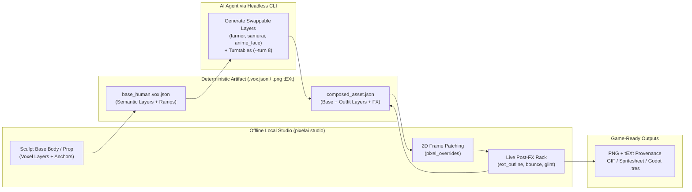
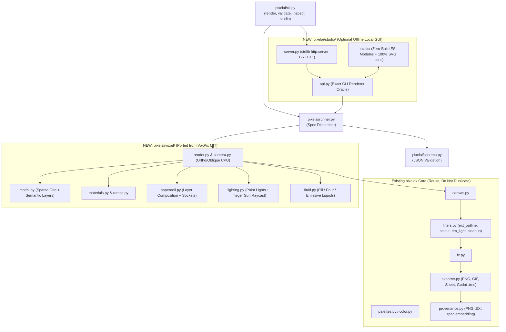

# PixelAI-Tools × VoxPix: Progressive Voxel Engine & Offline Studio Roadmap

> **Document Purpose:** Master architecture and phased implementation plan for integrating open-source voxel capabilities from [`andyeswong/voxpix`](https://github.com/andyeswong/voxpix) (MIT License) and a local offline graphical Studio (`pixelai studio`) into [`Tolgrim-arch/PixelAI-Tools`](https://github.com/Tolgrim-arch/PixelAI-Tools).
>
> **Designed for Stateless Sessions & Subagent Delegation:** Every phase is self-contained with explicit file boundaries, data contracts, verification gates, and anti-hallucination guardrails so any fresh agent or subagent can execute a single phase without prior chat history.

---

## 1. Goal Description

`PixelAI-Tools` excels at deterministic, CLI-first 2D pixel art (`char_rig`, `spine_rig`, `ik_limb`, `solid` SDF, Bayer 4×4 dithering, `ext_outline`/`selout`/`rim_light`/`cleanup`, and Godot 4 `.tres` export). However, two high-leverage workflows remain difficult or token-expensive in pure 2D CLI mode:

1. **Multi-Angle 3D Consistency & Paper-Doll Reuse:** Rotating characters, portraits, buildings, or items across 4/8 directions requires manual 2D coordinate redraws. Users cannot easily sculpt a reusable naked base body once and have an AI agent dress it via CLI with interchangeable outfits, hats, or facial layers.
2. **The "Last 10%" Polish Bottleneck:** Fixing a single stray pixel on frame 3, adding a quick bounce or vertical shine (`glint`) sweep, or tuning an outline currently requires expensive, error-prone LLM prompt roundtrips.

By porting the deterministic mathematical core of `voxpix` into Python (`pixelai/voxel/`) and pairing it with an optional, offline local browser Studio (`pixelai studio`), we enable a **Hybrid Human ↔ AI Workflow**:
- **Human sculpts** base voxel bodies, props, or portraits in the offline Studio while seeing the exact `PixelAI-Tools` pixel-art output in real time.
- **AI Agent operates strictly via CLI** to generate modular voxel outfit/face/item layers, animations, and multi-angle turntables on top of the user's base body.
- **Human polishes** individual 2D frames and quick micro-FX (`bounce`, `glint`, `outline`) in the Studio with **zero token cost**, stored non-destructively inside the same JSON spec and PNG `tEXt` provenance.

---

## 2. Subagent Onboarding & Anti-Hallucination Contract

> [!IMPORTANT]
> **Mandatory Reading for All Subagents:** Before writing a single line of code, every agent/subagent assigned to any phase of this roadmap MUST verify these ground-truth constraints against the repository.

### 2.1 Ground-Truth Constraints (Inherited from `PixelAI-Tools/AGENTS.md`)
1. **CLI-First Core:** `PixelAI-Tools` MUST remain 100% functional as a headless Python 3.11+ CLI tool (`Pillow>=10.0.0`). Never require a browser, Node.js, or GPU to run `pixelai render`, `validate`, `inspect`, or `export`.
2. **No `.exe` Bundling:** Never bundle desktop executables (Electron, Tauri, PyInstaller). The GUI is served locally on `127.0.0.1` via Python's stdlib `http.server` (`pixelai studio`).
3. **SVG Icons Only:** Per `AGENTS.md`, **all icons in the graphical interface MUST be SVG**. Zero raster PNG icon sheets or external icon CDN fonts (must work 100% offline).
4. **Mandatory Aesthetic Standard:**
   - Default (`style: "ext_outline"`): **Lineless Interior + 1px External Silhouette Outline Only**. Internal surfaces use pure color planes, bevels, and ramp-shifted shading with **zero internal dark outlines**.
   - Opt-in (`style: "lineless"` / `--lineless`): **Pure Lineless**.
   - **Forbidden:** Internal + external dark outlines.
5. **Closed-Palette Determinism:** Voxel lighting and shading MUST shift indices within palette ramps (`ramp * 16 + shade + 1`) rather than multiplying arbitrary RGB values, guaranteeing closed-palette output compatible with `pixelai/palettes.py`.
6. **SOLID / DRY / KISS:** Never duplicate pixel math, color parsing, outline filters, or PNG provenance logic. Reuse existing `pixelai/canvas.py`, `pixelai/filters.py`, `pixelai/palettes.py`, `pixelai/exporter.py`, and `pixelai/provenance.py`.
7. **Git Workflow Trailers:** Every commit message and Pull Request body MUST end with:
   ```text
   Co-authored-by: Claude <noreply@anthropic.com>
   Co-authored-by: Codex <noreply@openai.com>
   ```

### 2.2 Explicit Anti-Hallucination Rules (Do NOT Do)
- **DO NOT** invent CLI flags or JSON op names without registering them in `pixelai/schema.py`, `pixelai/cli.py`, and `pixelai/runner.py`.
- **DO NOT** import `voxpix`'s Vue 3, Vite, Bun, or WebGL2 runtime into the Python backend. Port only the deterministic algorithms (from `voxpix/src/core/*`, `src/lighting/*`, `src/fluid/*`) cleanly to Python.
- **DO NOT** allow AI outfit layers to mutate or overwrite the user's `body` voxel layer; composition MUST be additive/masked by layer priority.
- **DO NOT** overwrite human `pixel_overrides` when re-running CLI commands unless `--clear-overrides` is explicitly passed.
- **DO NOT** mark a phase complete until its exact **Verification Gate** passes with zero skipped assertions.

### 2.3 Subagent Handoff Protocol
When delegating a phase to a subagent, pass a structured prompt containing:
1. **Target Phase ID** (e.g., `Phase V1`).
2. **Exact File Allowlist** (only the `[NEW]` and `[MODIFY]` files listed in that phase).
3. **Upstream Contracts** (the JSON schemas/dataclasses from completed prior phases).
4. **Verification Command** (exact `pytest` + `pixelai` CLI command that must exit `0`).
5. **Required Output:** Summary of modified files, test output, and updated checkbox status in this roadmap.

---

## 3. System Architecture & Hybrid Workflow

### 3.1 Hybrid Human ↔ AI Loop



### 3.2 Package Layout & Integration Boundaries



---

## 4. User Review Required & Open Questions

> [!WARNING]
> **Key Design Decisions Requiring Your Approval Before Phase V0 Begins:**
> 1. **Optional NumPy Acceleration:** Pure Python + Pillow is fast enough for `32×32×32` character voxels (~15–40ms), while `128×128×64` landscapes benefit significantly from optional `numpy`. **Proposal:** Keep `Pillow>=10.0.0` as the sole mandatory dependency (preserving `pyproject.toml`), with an optional `pixelai-tools[fast]` extra (`numpy`) that transparently accelerates raycasting when installed.
> 2. **Studio Frontend Stack:** To keep `pixelai studio` 100% offline with zero Node/npm build step for end users, **Proposal:** Build `pixelai/studio/static/` using modular vanilla ES2022 JavaScript + CSS Variables + HTML5 2D Canvas (plus optional WebGL2 viewport for 3D orbit, toggleable to CPU oracle) and inline SVG icons. No React/Vue/Vite build step required.
> 3. **File Format for Voxel Assets:** **Proposal:** Support both inline `"op": "voxel_model"` inside standard `PixelAI-Tools` JSON specs AND standalone reusable `.vox.json` files referenced via `"extends"` / `"voxel_layers"` so AI agents can compose outfits onto a user's base body cleanly.

---

## 5. Progressive Phased Roadmap

### Phase Status Tracker (Update After Every Completed Phase)
- [x] **Phase V0:** Sparse Voxel Model, Semantic Layers & Ramp Material Bridge
- [x] **Phase V1:** Deterministic CPU Voxel-to-Pixel Renderer & Multi-Angle Turntables
- [x] **Phase V2:** Paper-Doll Layering, Anchor Sockets, Portraits & Rotatable Items
- [x] **Phase V3:** 3D Point Lighting, Integer Raycast Shadows & Deterministic Fluids
- [x] **Phase V4:** Non-Destructive 2D `pixel_overrides` & Quick Micro-FX (`bounce`, `glint`)
- [x] **Phase V5:** Offline Local Studio Backend (`pixelai studio` Server & Oracle API)
- [x] **Phase V6:** Studio Frontend UI & UX (Voxel Sculptor, 2D Frame Editor, Live FX Rack)
- [x] **Phase V7:** End-to-End Hybrid Benchmarks, Parity Oracle & Documentation

---

### Phase V0: Sparse Voxel Model, Semantic Layers & Ramp Material Bridge

**Goal:** Establish the foundational 3D sparse voxel data structure, named semantic layers, anchor sockets, and closed-palette ramp/material system inspired by `voxpix/src/core/model.ts`, `materials.ts`, and `palette.ts`.

#### Proposed Files
- `[NEW] pixelai/voxel/__init__.py`
- `[NEW] pixelai/voxel/model.py` — Sparse integer grid (`-1023..1023` on X/Y/Z, X=east, Y=north, Z=up, pivot at `(0,0,0)`), named semantic layers (`VoxelLayer`), anchor sockets (`head`, `torso`, `hand_l`, `hand_r`, `feet`), and deterministic JSON serialization (`.vox.json`).
- `[NEW] pixelai/voxel/materials.py` — Data-driven material table (`solid`, `foliage`, `bush`, `glass`, `metal`, `emissive`) with properties (`light`, `backlit`, `bed`, `blocks`, `emissive`).
- `[NEW] pixelai/voxel/ramps.py` — Closed-palette ramp encoding (`value = ramp_index * 16 + shade_index + 1`, `0 = empty`), up to 64 ramps × 16 shades, bridging directly to `pixelai/palettes.py` (`cozy24`, `endesga32`, `sweetie16`, `pico8`, `mistria_portrait`) and OKLCH hue-shifted ramp generation.
- `[MODIFY] pixelai/schema.py` — Register `voxel_model` schema and strict field validation.

#### Core Data Contract (`.vox.json`)
```json
{
  "format": "pixelai.voxel.v1",
  "bounds": { "w": 32, "d": 32, "h": 48 },
  "pivot": [0, 0, 0],
  "palette_ref": "cozy24",
  "ramps": [
    { "name": "skin", "colors": ["#8d5524", "#c68642", "#e0ac69", "#f1c27d"], "material": "solid" },
    { "name": "lantern_glow", "colors": ["#ffaa33", "#fff099"], "material": "emissive" }
  ],
  "sockets": {
    "head": [0, 0, 26],
    "hand_r": [7, 0, 14]
  },
  "layers": [
    {
      "id": "body_base",
      "role": "body",
      "locked": true,
      "visible": true,
      "priority": 0,
      "voxels": [[0, 0, 0, 17]]
    }
  ]
}
```

#### Verification Gate (V0)
- `[NEW] tests/test_voxel_model.py`
- Verify: sparse roundtrip serialization, coordinate bounds rejection, ramp index encoding/decoding, closed-palette invariant, and layer priority resolution.
- Command: `pytest tests/test_voxel_model.py -v`

---

### Phase V1: Deterministic CPU Voxel-to-Pixel Renderer & Multi-Angle Turntables

**Goal:** Render any `VoxelModel` into a `pixelai.canvas.Canvas` with exact byte-for-byte determinism, supporting orthographic and 3/4 oblique cameras, multi-angle turntables (`4` or `8` directions), and native `PixelAI-Tools` post-processing (`ext_outline`, `lineless`, `rim_light`, `cleanup`).

#### Proposed Files
- `[NEW] pixelai/voxel/camera.py` — Orthographic (`yaw`, `elevation`, `ppu`) and 3/4 Oblique (`oblique: {y, z}`) projection math with pivot-locked `originX`/`originY` (zero jitter when rotating).
- `[NEW] pixelai/voxel/render.py` — Deterministic CPU voxel rasterizer ported from `voxpix/src/core/render.ts`:
  - Fixed screen-space top-left directional light (stays consistent as model rotates).
  - Air-neighbor normal smoothing (`smooth`) and corner ambient occlusion (`ao`).
  - Ramp-index shifting (`thresholds`) so output stays strictly inside the palette.
  - Emits both color `Canvas` and auxiliary depth/layer-ID buffer (used by `rim_light` and Studio picking).
- `[MODIFY] pixelai/runner.py` — Add `"op": "voxel_model"` and `"op": "voxel_turntable"` execution paths, feeding directly into existing `pixelai/filters.py` (`ext_outline`, `selout`, `cleanup`, `rim_light`).
- `[MODIFY] pixelai/cli.py` — Add `--turn <N>` / `--yaw` / `--elev` flags and `guide --op voxel_model`.

#### Verification Gate (V1)
- `[NEW] tests/test_voxel_render.py`
- Verify: deterministic hash across repeated runs, pivot stability across 8 yaw angles (`0°..315°`), zero internal dark outlines under `style: "ext_outline"`, closed-palette check, and valid PNG `tEXt` provenance embedding.
- Command: `pytest tests/test_voxel_render.py -v && pixelai render samples/voxel_cube.json -o /tmp/v1_test.png`

---

### Phase V2: Paper-Doll Layering, Anchor Sockets, Portraits & Rotatable Items

**Goal:** Enable the signature Human ↔ AI workflow: a user creates a base naked body in `.vox.json`, and an AI agent generates interchangeable clothing, hats, hair, weapons, and facial expressions via CLI—plus voxel-backed portraits and 360° rotatable RPG items.

#### Proposed Files
- `[NEW] pixelai/voxel/paperdoll.py` — Multi-file layer composer:
  - Loads a base model (`base_ref: "base_human.vox.json"`) and merges ordered overlay layers (`clothes`, `hat`, `face`, `hair`, `accessory`).
  - Supports **socket-relative placement** (e.g., attach a samurai helmet relative to `sockets.head` so it fits automatically even if body height changes).
  - Supports **voxel shell/inflate helpers** (`shell_around: "body_base"`, `region_z: [10, 22]`, `thickness: 1`) so AI agents can wrap shirts, coats, or armor cleanly around any user-sculpted body without z-fighting or clipping.
  - Supports **masking/culling** (e.g., helmet layer hides overlapping hair voxels).
- `[NEW] pixelai/voxel/primitives.py` — High-level declarative voxel ops for AI CLI scripts (`vox_box`, `vox_ellipsoid`, `vox_cylinder`, `vox_mirror`, `vox_shell`, `vox_carve`) so agents never have to emit thousands of raw `[x, y, z, val]` tuples.
- `[MODIFY] pixelai/runner.py` & `pixelai/schema.py` — Register `voxel_compose` and `voxel_portrait` / `voxel_item_spin` presets.

#### Verification Gate (V2)
- `[NEW] tests/test_voxel_paperdoll.py`
- Verify: composing `farmer_outfit` + `anime_face` onto a locked `body_base` never mutates `body_base`, renders cleanly across 4 & 8 directions, and fits `sockets.head` after body translation/height changes.
- Command: `pytest tests/test_voxel_paperdoll.py -v`

---

### Phase V3: 3D Point Lighting, Integer Raycast Shadows & Deterministic Fluids

**Goal:** Port `voxpix`'s deterministic 3D lighting (`src/lighting/*`) and voxel fluid simulation (`src/fluid/voxel.ts`) to elevate night scenes, enchanted items, lanterns, and environmental dioramas.

#### Proposed Files
- `[NEW] pixelai/voxel/lighting.py` —
  - Integer sun-shadow raycasting (`cost = round(-log2(light) * 4)` with deterministic position-hashed canopy mottling for foliage).
  - Multi-source point lights (`torch`, `lantern`, `brazier`, `neon`, custom color/radius/falloff) with 3D occlusion.
  - Translates accumulated light energy strictly into palette ramp shade shifts + emissive bypass.
- `[NEW] pixelai/voxel/fluid.py` — Deterministic cellular voxel fluid solver (`pour`, `fill_level`, `basin_fill`) respecting material `bed` flags, supporting water, lava, and glowing/emissive liquids, with `"bake": true` to freeze into static voxels.
- `[MODIFY] pixelai/voxel/render.py` — Integrate optional lighting and fluid passes before 2D projection.

#### Verification Gate (V3)
- `[NEW] tests/test_voxel_lighting_fluid.py`
- Verify: deterministic shadow bit-equality, foliage mottled shadow attenuation, point-light occlusion behind solid walls, fluid basin containment, and strict closed-palette preservation.
- Command: `pytest tests/test_voxel_lighting_fluid.py -v`

---

### Phase V4: Non-Destructive 2D `pixel_overrides` & Quick Micro-FX Nodes

**Goal:** Eliminate token waste on minor artistic polish. Allow humans (via Studio or JSON) to apply per-frame 2D pixel patches and instant micro-FX (`bounce`, `glint` vertical shine sweep, `flash`, `outline_tint`) on top of any 2D or Voxel asset without losing AI re-generatability.

#### Proposed Files
- `[NEW] pixelai/overrides.py` — Declarative per-frame patch layer:
  ```json
  "pixel_overrides": {
    "frame_0": { "set": [[12, 18, "#fff4d6"]], "erase": [[11, 18]] },
    "frame_2": { "set": [[13, 17, "#fff4d6"]] }
  }
  ```
  Applied deterministically after base render and optionally before or after `ext_outline` (`"stage": "pre_outline" | "post_outline"`).
- `[MODIFY] pixelai/fx.py` — Add deterministic micro-FX nodes:
  - `bounce`: sub-frame/integer vertical squash-and-stretch or hop curve (`amplitude_px`, `period_frames`, `squash`).
  - `glint`: fast vertical/diagonal specular shine sweep across non-transparent silhouette pixels (`angle`, `width_px`, `speed`, `color` or ramp highlight).
  - `palette_swap`: instant ramp/color remapping node.
- `[MODIFY] pixelai/provenance.py` — Ensure `pixel_overrides` and micro-FX are preserved in PNG `tEXt` chunks and respected by `pixelai extract` and `"extends"`.

#### Verification Gate (V4)
- `[NEW] tests/test_overrides_microfx.py`
- Verify: `pixel_overrides` survive `render -> extract -> re-render` roundtrip; `bounce` and `glint` produce deterministic multi-frame GIF/spritesheet outputs with zero mixels.
- Command: `pytest tests/test_overrides_microfx.py -v`

---

### Phase V5: Offline Local Studio Backend (`pixelai studio`)

**Goal:** Provide a lightweight, zero-external-dependency local server (`127.0.0.1`) that serves the Studio UI and exposes the exact same Python rendering/exporting engine used by the CLI (guaranteed 1:1 pixel parity).

#### Proposed Files
- `[NEW] pixelai/studio/__init__.py`
- `[NEW] pixelai/studio/server.py` — `pixelai studio [file.json|.vox.json|.png] [--port 5190] [--no-browser]` using Python stdlib `http.server.ThreadingHTTPServer` bound strictly to `127.0.0.1` (offline-only, zero telemetry).
- `[NEW] pixelai/studio/api.py` — Clean JSON REST endpoints:
  - `GET /api/project` — Loads current spec (auto-extracting from PNG `tEXt` if a `.png` was opened).
  - `POST /api/render` — Renders current in-memory spec/voxel model + overrides + FX via `pixelai.runner`, returning base64 PNGs (native + turntable angles + frame strip) and depth/picking maps.
  - `POST /api/save` — Atomically writes `.json` / `.vox.json` to disk.
  - `POST /api/export` — Exports `.png`, `.gif`, spritesheet `.png` + `.json`, or Godot 4 `.tres` using `pixelai/exporter.py`.
  - `GET /api/palettes` — Lists built-in `PixelAI-Tools` palettes and ramp presets.
- `[MODIFY] pixelai/cli.py` — Register `studio` subcommand with full `--help`.

#### Verification Gate (V5)
- `[NEW] tests/test_studio_api.py`
- Verify: `/api/render` produces **byte-identical PNG pixels** to `pixelai render` CLI (Oracle Parity Test); atomic save works; server binds strictly to `127.0.0.1` and shuts down cleanly.
- Command: `pytest tests/test_studio_api.py -v`

---

### Phase V6: Studio Frontend — UI & UX Architecture (Offline Browser App)

**Goal:** Build a crisp, dark-mode, pixel-art-native offline web interface (`pixelai/studio/static/`) with **100% inline SVG icons** (zero external CDNs, zero build step) structured around 3 cohesive workspaces so users never fight complex menus.

#### UX Design & Layout Blueprint

```text
+-----------------------------------------------------------------------------------+
| [SVG Logo] PixelAI Studio | File: base_human.vox.json | [Voxel] [2D Frames] [FX]  |
|                           | [Undo] [Redo]             | [Copy CLI] [Save] [Export]|
+------------------+-------------------------------------------+--------------------+
| LEFT DOCK        | MAIN VIEWPORT (Integer Pixel Scaling)     | RIGHT DOCK         |
|                  |                                           |                    |
| (In Voxel Mode)  |  - Voxel Mode:                            | LIVE PIXEL PREVIEW |
| - Semantic Layers|    [Tab] toggles Z-Slice (ghost below)    | (Exact CLI Oracle) |
|   [🔒] body_base |    vs. 3D Orbit View (RMB orbit, MMB pan) |  [ Turntable 8x ]  |
|   [👁] outfit    |                                           |  Yaw / Elev / PPU  |
|   [👁] hat       |  - 2D Frame Mode:                         |                    |
|   [👁] face      |    Native-grid Canvas + Onion Skinning    | POST-FX RACK       |
| - Z-Layer Slider |    + Diff Toggle (AI Base vs. User Patch) |  [x] ext_outline   |
| - Anchor Sockets |                                           |  [ ] lineless      |
|                  |                                           |  [x] rim_light     |
| (In 2D Mode)     |                                           |  [x] cleanup       |
| - Frame List     |                                           |  [x] bounce (2px)  |
| - Override Stats |                                           |  [x] glint (sweep) |
+------------------+-------------------------------------------+--------------------+
| BOTTOM BAR: [SVG Tools: B E P I R G L F M] | Active Ramp Swatches [▲ Full Palette]|
| STATUS: Cell (x,y,z) | Voxels: 412 | Render: 18ms (CPU Oracle) | Zoom: 8x         |
+-----------------------------------------------------------------------------------+
```

#### Proposed Files
- `[NEW] pixelai/studio/static/index.html` — Semantic shell, zero external `<link>`/`<script>` tags.
- `[NEW] pixelai/studio/static/styles.css` — Dark studio theme (`#14161b` surface, `#1e222a` panels, crisp `image-rendering: pixelated`), responsive dock layout, keyboard shortcut badges.
- `[NEW] pixelai/studio/static/icons.js` — **100% SVG icon library** (Pencil, Eraser, Repaint, Eyedropper, Box, Bucket, Light, Fluid, Mirror, Eye, Lock, Layers, Play/Pause, Onion Skin, Export, Undo/Redo, Reset Camera).
- `[NEW] pixelai/studio/static/state.js` — Centralized immutable state store + Undo/Redo command stack (`Ctrl+Z` / `Ctrl+Y`) tracking voxel strokes, layer edits, palette changes, `pixel_overrides`, and FX sliders.
- `[NEW] pixelai/studio/static/voxel_viewport.js` —
  - **Z-Slice Editor:** Top-down slice painting with ghosted `z-1` layer, mouse-wheel / `W`/`S` slice stepping, mirror axis `M`, box `R`, flood fill `G`.
  - **3D Orbit Viewport:** Interactive 3D voxel painting on hovered face normal, RMB orbit, MMB pan, wheel zoom, anchor socket gizmos.
- `[NEW] pixelai/studio/static/frame_editor.js` —
  - Native-resolution integer-zoom 2D canvas for patching `pixel_overrides` per frame.
  - Animation timeline (Play/Pause, FPS, per-frame duration, onion-skinning prev/next frame).
  - **"AI Diff" toggle:** Highlights user-patched pixels vs. raw AI-rendered pixels.
- `[NEW] pixelai/studio/static/fx_palette_dock.js` —
  - Live toggles/sliders for `ext_outline` / `lineless`, `selout`, `rim_light`, `cleanup`, `bounce`, `glint`, and turntable angle preview (`4` or `8` directions).
  - Ramp Palette Editor (ported UX from `voxpix`: ramp swatches, emissive toggle, OKLCH hue-shifted ramp generator, Lospec `.hex`/`.gpl` import).
  - **"Copy CLI Prompt / Command" button:** Copies the exact `pixelai` CLI command or layer reference snippet so the user can hand off their sculpted base body straight to an AI coding agent.

#### UX Ergonomics Checklist
- Every tool has a single-key shortcut matching `voxpix` conventions (`B`, `E`, `P`, `I`, `R`, `G`, `L`, `F`, `M`, `Tab`, `Space` play/pause).
- Debounced live preview (e.g., 50ms) to `/api/render` with immediate optimistic local stroke drawing so painting feels 60fps even on CPU.
- Zero destructive actions without Undo (`Ctrl+Z` reverts voxel edits, palette swaps, and 2D overrides uniformly).

#### Verification Gate (V6)
- `[NEW] tests/test_studio_static.py` — Automated static audit verifying:
  - Zero external HTTP/CDN URLs in `pixelai/studio/static/*` (100% offline guarantee).
  - Zero raster `.png`/`.jpg` UI icons (100% SVG icon rule from `AGENTS.md`).
  - All API endpoints referenced by JS exist in `pixelai/studio/api.py`.
- Manual UX verification checklist (open `pixelai studio`, sculpt base body, toggle `Tab` 2D/3D, inspect 8-angle turntable, patch 1 pixel in Frame 2, enable `glint`, export `.gif` + `.tres`).

---

### Phase V7: End-to-End Hybrid Benchmark, Oracle Parity & Agent Skill Update

**Goal:** Prove the full Human ↔ AI workflow end-to-end and teach AI agents how to use the new voxel/paper-doll capabilities automatically.

#### Proposed Files
- `[NEW] samples/base_human.vox.json` — Reference sculpted naked humanoid base body with `head`, `torso`, `hand_r`, `feet` sockets.
- `[NEW] samples/outfit_farmer.json` & `[NEW] samples/outfit_samurai.json` — Reference CLI-generated swappable outfit + face specs layered onto `base_human.vox.json` with 8-direction turntable output.
- `[NEW] samples/item_potion_spin.json` — Reference 360° rotating voxel RPG item with emissive liquid + `glint` FX.
- `[MODIFY] SKILL.md` & `AGENTS.md` — Document `voxel_model`, `voxel_compose`, `pixel_overrides`, `bounce`/`glint`, and the `pixelai studio` handoff workflow for AI agents.
- `[NEW] tests/test_hybrid_e2e.py` — End-to-end integration test:
  1. Load `base_human.vox.json`.
  2. Compose `outfit_farmer` via CLI (`pixelai render --turn 8`).
  3. Apply `pixel_overrides` + `bounce` + `glint` via Studio API.
  4. Verify CLI re-render == Studio API render (pixel-for-pixel).
  5. Verify exported PNG `tEXt` metadata retains all layers and overrides, and Godot 4 `.tres` is valid.

#### Verification Gate (V7)
- Command: `pytest tests/ -v` (full regression suite, zero regressions in existing 2D/isometric/architecture/UI tests).

---

## 6. Verification Plan Summary

### Automated Tests (Per-Phase & Full Regression)
```bash
# Run per-phase unit tests as each phase completes
pytest tests/test_voxel_model.py -v
pytest tests/test_voxel_render.py -v
pytest tests/test_voxel_paperdoll.py -v
pytest tests/test_voxel_lighting_fluid.py -v
pytest tests/test_overrides_microfx.py -v
pytest tests/test_studio_api.py -v
pytest tests/test_studio_static.py -v
pytest tests/test_hybrid_e2e.py -v

# Full PixelAI-Tools regression suite
pytest -v
```

### Manual Verification (Human-in-the-Loop UX)
1. Launch `pixelai studio samples/base_human.vox.json` offline (with network disconnected).
2. Verify all toolbar/dock icons render crisply as SVGs.
3. Sculpt a modification on `body_base`, press `Tab` to verify 2D slice ↔ 3D orbit sync, and check the 8-angle turntable preview.
4. Click **Copy CLI**, run the AI outfit composition command, reload in Studio, switch to **2D Frames**, patch 2 pixels on Frame 1, toggle `ext_outline` + `bounce` + `glint`, and export `.gif` + Godot `.tres`.
5. Confirm re-running `pixelai render` from CLI reproduces the exact Studio image including the manual pixel patch.
